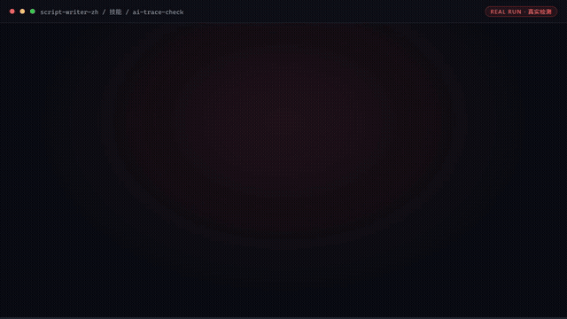

# 脚本创作师

> **从选题到过检成稿的脚本流水线，写得快且不被限流**



*▲ 真实执行录播（自动循环播放）· [▶ 观看完整版合集视频](docs/demo.mp4)*

[](https://github.com/bangwozuo)
[-blueviolet)](#技能清单)
[](#资产形态)
[](LICENSE)

---

## 它是谁

面向 **自媒体创作者** 的数字员工资产包。

| 项目 | 内容 |
|------|------|
| 目标用户 | 短视频/直播创作者（亿级账号池），日更/隔日更口播类作者 |
| 交付物 | 单脚本产出时长 ≤15 分钟（原 3-6h 创作环节中的写作段）；AI 检测通过率 ≥90%；成片采用率 ≥60% |
| 资产数 | 10（6 技能 + 4 工作流），其中 6 个带确定性脚本、可实跑出 Excel/PNG 产物 |
| 旧名存档 | `短视频脚本创作师` |

### 数字员工总览：一条脚本流水线

「脚本创作师」不是一个工具，而是一条**从选题到过检出稿的完整链路**——10 个资产各守一段，量化标准互相咬合：

```text
选题 ──▶ 钩子锻造（首句≤15字·3s出信息差）
     ──▶ 结构成稿（四段式·语速3.5-6字/秒·60s=240-300字）
     ──▶ 口语化改写（衔接词<1/千字·句长8-14字·CV≥0.5）
     ──▶ 人设语气（五维画像·脚本实跑 voice_profile.py）
     ──▶ 发布前闸门（五维AI痕迹分<30 + 敏感词零红线，才放行）
```

每个环节「该用什么数字卡、卡不住怎么办」见下方[资产矩阵](#技能清单)。

## 资产形态

**T1/T2/T3 分层** —— 这是理解本仓库的关键：

| 层 | 形态 | 数量 | 说明 |
|------|------|------|------|
| T1 产物型 | 技能 + 脚本 | 2 | 脚本实跑出 Excel/PNG/JSON 产物（ai-trace-check、persona-voice-library） |
| T2 纯提示词 | 仅提示词 | 4 | 复制粘贴即用，零脚本零依赖（钩子/结构/口语化/敏感词） |
| T3 编排型 | 工作流 + 脚本 | 4 | 编排 T1/T2 资产成链路，校验环节脚本确定性执行 |

| 特性 | 说明 |
|------|------|
| ✅ 无需 API Key | 一个 Key 都不需要 |
| ✅ 无需部署 | 脚本只依赖 Python 标准库 + openpyxl，纯提示词资产零依赖 |
| ✅ 平台无关 | 提示词粘贴到任何 AI 工具即可使用 |
| ✅ 用户自备算力 | 模型来自你自己的订阅 |
| ✅ 校验不靠口算 | 凡是数字判定（字数/语速/痕迹分/词表），一律脚本实跑 |

---

## 快速开始

```text
1. 打开 skills/script-structure-generate/prompt.txt
2. 全文复制
3. 粘贴到你常用的 AI 工具（Coze / WorkBuddy / Dify / Claude / ChatGPT）
4. 按 SKILL.md 的输入规格提供数据
```

就这四步。完整指引见 [使用手册](docs/04-usage.md)。带脚本的资产可直接实跑演示：

```bash
python skills/ai-trace-check/scripts/ai_trace_check.py --demo
python workflows/topic-to-script-flow/scripts/run_flow.py --demo
```

---

## 仓库结构

```text
script-writer-zh/
├── README.md / employee.md / package.yaml     # 入口与 12 字段定义卡
├── docs/01~07 + demo.mp4                      # 员工级文档（架构/流程/场景/手册/示例/录像/测试）+ 演示视频
├── skills/                                    # 6 个原子技能（2 个带脚本）
│   └── <skill>/
│       ├── README.md  SKILL.md  prompt.txt  schema.json  examples/
│       ├── scripts/                           # （部分资产）确定性脚本
│       ├── out/                               # （部分资产）脚本实跑产物
│       └── docs/                              # 该技能自己的文档 + assets/ 实跑截图
├── workflows/                                 # 4 条工作流（复合技能，均带脚本）
│   └── <workflow>/
│       ├── README.md  SKILL.md  prompt.txt  schema.json  examples/
│       ├── scripts/run_flow.py                # 链路校验脚本（确定性执行）
│       ├── out/                               # 实跑产物（xlsx / png / json）
│       └── docs/                              # 该工作流自己的文档 + assets/ 实跑截图
├── knowledge/                                 # RAG wiki 知识库
├── connectors/                                # 连接器说明 + 合规红线
├── quality/                                   # 效果基线与追踪日志
└── tests/                                     # 资产校验测试（离线，无需密钥）
```

---

## 交付物导航

| 文档 | 内容 |
|------|------|
| [业务架构](docs/01-architecture.md) | 四层架构 + 数据流 + 能力边界 |
| [工作流流程](docs/02-workflow.md) | 4 条工作流的 DAG 可视化 |
| [使用场景](docs/03-scenarios.md) | 3 个真实场景（含前后对比） |
| [使用手册](docs/04-usage.md) | 各平台导入指引 + 常见问题 |
| [示例库](docs/05-examples.md) | 6 组输入输出示例 |
| [录像脚本](docs/06-recording-script.md) | 7 镜头分镜 + 旁白稿 |
| [校验报告](docs/07-test-report.md) | 资产质量校验结果 |
| [演示视频](https://cdn.jsdelivr.net/gh/bangwozuo/script-writer-zh@main/docs/demo.mp4) | 5 个资产真实执行截图串编（20s） |

---

## 技能清单（6 个）

| # | 技能 | 能力族 | 复杂度 | 提示词 | 文档 |
|---|------|--------|--------|--------|------|
| 1 | 脚本结构生成 | 脚本与分镜生成 | `S` | [prompt.txt](skills/script-structure-generate/prompt.txt) | [docs](skills/script-structure-generate/docs/) |
| 2 | 钩子文案锻造 | 钩子与创意生成 | `S` | [prompt.txt](skills/hook-copy-craft/prompt.txt) | [docs](skills/hook-copy-craft/docs/) |
| 3 | 口语化改写 | 改写与适配 | `S` | [prompt.txt](skills/colloquial-rewrite/prompt.txt) | [docs](skills/colloquial-rewrite/docs/) |
| 4 | 人设语气库 | 摘要与聚类 | `S` | [prompt.txt](skills/persona-voice-library/prompt.txt) | [docs](skills/persona-voice-library/docs/) |
| 5 | AI 痕迹自检 | 异动检测与预警 | `M` | [prompt.txt](skills/ai-trace-check/prompt.txt) | [docs](skills/ai-trace-check/docs/) |
| 6 | 敏感词预审 | 合规校验 | `M` | [prompt.txt](skills/sensitive-word-precheck/prompt.txt) | [docs](skills/sensitive-word-precheck/docs/) |

## 工作流清单（4 条）

| # | 工作流 | 阶段 | 复杂度 | 触发 | 定义 | 文档 |
|---|--------|------|--------|------|------|------|
| 1 | 选题转脚本 | `P0` | `S` | 人工（选题确认后） | [SKILL.md](workflows/topic-to-script-flow/SKILL.md) | [docs](workflows/topic-to-script-flow/docs/) |
| 2 | 口播稿口语化改写 | `P0` | `S` | 事件（WF1 后自动） | [SKILL.md](workflows/voiceover-colloquial-flow/SKILL.md) | [docs](workflows/voiceover-colloquial-flow/docs/) |
| 3 | 分镜与拍摄清单 | `P1` | `S` | 人工（按需） | [SKILL.md](workflows/storyboard-shotlist-flow/SKILL.md) | [docs](workflows/storyboard-shotlist-flow/docs/) |
| 4 | AI 痕迹检测与降 AI 味 | `P0` | `M` | 事件（交付前强制闸门） | [SKILL.md](workflows/ai-trace-detect-reduce-flow/SKILL.md) | [docs](workflows/ai-trace-detect-reduce-flow/docs/) |

---

## 知识库与连接器

| 目录 | 说明 |
|------|------|
| [`knowledge/`](knowledge/README.md) | RAG wiki 知识库：填入业务信息可显著提升输出质量 |
| [`connectors/`](connectors/README.md) | 连接器说明：数据从哪来、怎么合规地来 |

---

## 资产校验

```bash
pip install -r requirements.txt
pytest tests/ -v
```

校验技能完整性、提示词结构、契约一致性、工作流 DAG、技能级与工作流级 docs 完整性、知识库 wiki 与连接器结构。
**不需要任何 API Key。**

---

## 合规声明

- ✅ 所有输出为 **AI 辅助生成**，交付前须人工审核
- ✅ 提示词内置**违禁词禁止清单**，符合《广告法》要求
- ✅ 遵循《人工智能生成合成内容标识办法》
- ✅ 连接器只走**官方 API** 或**用户导出数据**
- ✅ 所有对外发布动作**保留人工确认环节**（工作流 #10 的人工签发闸门不可跳过）

---

## 许可

[Apache-2.0](LICENSE) — 可自由使用、修改、商用

---

*由 bangwozuo 业务库自动生成 · 2026-09-29 · README 投产级改造 2026-10-03*
